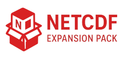
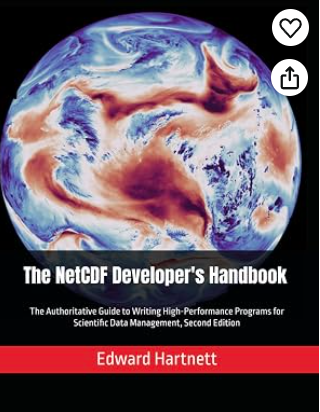

# NEP (NetCDF Expansion Pack)

**[📚 Full Documentation](https://intelligent-data-design-inc.github.io/NEP/)**

**[NEXTCDF-4 Documentation](docs/nextcdf4.md)**

**[📄 NEP Abstract](docs/NEP_abstract.md)**

<a href="https://www.amazon.com/NetCDF-Developers-Handbook-Authoritative-High-Performance/dp/B0H7Q49MPS/">
  
</a>

[*The NetCDF Developer's Handbook: The Authoritative Guide to Writing High-Performance Programs for Scientific Data Management, Second Edition*](https://www.amazon.com/NetCDF-Developers-Handbook-Authoritative-High-Performance/dp/B0H7Q49MPS/) provides practical guidance and complete examples for NetCDF programming in C and Fortran.

---

## Summary

NEP extends NetCDF-C with scientific format readers, the NEXTCDF-4 backend,
and examples covering advanced NetCDF use. LZ4/BZIP2 compression lives in
[nep-compress](https://github.com/captainkirk99/nep-compress).

### Compression

For LZ4 or BZIP2 with NetCDF-4/HDF5, install
[nep-compress](https://github.com/captainkirk99/nep-compress) separately.
NEP continues to support generic HDF5 filters through NEXTCDF-4 but does
not build or install compression plugins or filter-specific APIs.

### Multi-Format Readers

Read other formats with the netcdf-c library, as if they were netCDF files.

| Format | Domain |
|---|---|
| **NASA CDF** | Space physics (IMAP, MMS, Van Allen) |
| **GeoTIFF** | Geospatial rasters, CF-1.8 CRS metadata |
| **GRIB2** | NWP model output (GFS, NAM, HRRR, wave) |
| **FITS** | Astronomical images and tables (HST, JWST) |
| **PDS4** | NASA/ESA planetary science (Mars, Moon, etc.) |
| **DICOM** | Medical imaging (CT, MR, XA, US) |
| **Legacy PDB** | Protein/macromolecular structures (RCSB) |

All readers use the standard NetCDF UDF system. Once enabled, **existing C and Fortran programs require no code modification** — an existing Fortran program that calls `nf90_open()` and `nf90_get_var()` can read a FITS, CDF, GeoTIFF, GRIB2, or PDS4 file without changing code.

Enable one or more readers at configure time:

```bash
# CMake
cmake -B build \
  -DNEP_ENABLE_GEOTIFF=ON \
  -DNEP_ENABLE_GRIB2=ON \
  -DNEP_ENABLE_CDF=ON \
  -DNEP_ENABLE_FITS=ON \
  -DNEP_ENABLE_PDS4=ON \
  -DNEP_ENABLE_DICOM=ON \
  -DNEP_ENABLE_PDB=ON
```

### Example Programs

NEP includes over 26 C and Fortran example programs, organized by topic. They are companion code for *[The NetCDF Developer's Handbook: The Authoritative Guide to Writing High-Performance Programs for Scientific Data Management, Second Edition](https://www.amazon.com/NetCDF-Developers-Handbook-Authoritative-High-Performance/dp/B0H7Q49MPS/)*.

| Category | Examples |
|---|---|
| **Classic NetCDF** | Quickstart, 2D arrays, coord vars, format variants, unlimited dims |
| **NetCDF-4** | Compression, chunking, groups, compound/enum types, multiple unlimited dims |
| **NcZarr** | Local store create/read/write, chunking, deflate compression |
| **Performance** | Chunk cache tuning, chunking strategy comparison, standard NetCDF compression examples |
| **Parallel I/O** | MPI-based parallel write and read |

Both C and Fortran versions provided for Classic, NetCDF-4, and NcZarr categories.

### Earth Observation Examples

Mission-by-mission satellite-data examples, data-access instructions, and Python visualizations formerly hosted in NEP are maintained in the [Earth Observation in Practice](https://github.com/captainkirk99/Earth_Observation_in_Practice) repository.

The companion book, [*Earth Observation in Practice: A Mission-by-Mission Guide to Reading Satellite Data with NetCDF and Python*](https://www.amazon.com/Earth-Observation-Practice-Mission-Mission/dp/B0HJRZ9F7L/), provides additional background and worked examples. These external resources are informational and are not build-time, run-time, test-time, or packaging dependencies of NEP.

---

## Compression

LZ4/BZIP2 plugins, C/Fortran APIs, tests, and documentation moved to
[nep-compress](https://github.com/captainkirk99/nep-compress). See its
[compression guide](https://github.com/captainkirk99/nep-compress/blob/main/docs/compression.md)
when upgrading an application that previously used NEP's `<nep.h>`,
`libnep`, or Fortran `use nep`.

---

## Installation

### Build Requirements

- **NetCDF-C >= 4.10.1** (required for UDF slots > 2, which NEP uses for FITS, CDF, and PDS4)
- **HDF5 >= 2.1.1** (required by NetCDF-4)
- C compiler and, optionally, a Fortran 90+ compiler
- Doxygen and Graphviz (only if building documentation)

### Ubuntu / Debian Dependencies

The core build tools and optional format/reader packages can be installed with `apt`.
NetCDF-C and HDF5 should usually be built from source to guarantee matching versions (see below).

| Feature | Install command | Notes |
|---|---|---|
| Core build tools | `sudo apt-get install build-essential cmake pkg-config` | Required for every build |
| Fortran format tests / examples | `sudo apt-get install gfortran` | Also requires a matching NetCDF-Fortran installation |
| Documentation | `sudo apt-get install doxygen graphviz` | Optional |
| GeoTIFF reader | `sudo apt-get install libgeotiff-dev libtiff-dev` | |
| FITS reader | `sudo apt-get install libcfitsio-dev` | |
| GRIB2 reader | `sudo apt-get install libjasper-dev` | NCEPLIBS-g2c must be built separately |
| NASA CDF reader | — | Not packaged; build from [SPDF CDF](https://spdf.gsfc.nasa.gov/pub/software/cdf/dist/latest/) or use `spack install cdf` |
| PDS4 reader | `sudo apt-get install libxml2-dev` | |
| DICOM reader | `sudo apt-get install libdicom-dev libjpeg-dev libgdcm-dev` | `libgdcm-dev` is required because most DICOM images use JPEG Lossless transfer syntaxes |
| Legacy PDB / mmCIF reader | — | No external packages needed |

### CMake Build and Installation

```bash
# Configure
cmake -B build -DCMAKE_INSTALL_PREFIX=/usr/local

# Build
cmake --build build

# Build documentation (optional)
cmake --build build --target docs

# Install
cmake --install build

# Uninstall (if needed)
cmake --build build --target uninstall
```

**Note:** If HDF5 is installed in a non-standard location, you may need to specify `HDF5_ROOT`:

```bash
cmake -B build -DHDF5_ROOT=/path/to/hdf5 -DCMAKE_INSTALL_PREFIX=/usr/local
```

For example, if HDF5 2.1.1 is installed in `/usr/local/hdf5-2.1.1`:

```bash
cmake -B build -DHDF5_ROOT=/usr/local/hdf5-2.1.1 -DCMAKE_INSTALL_PREFIX=/usr/local
```

NEP must use the same HDF5 as NetCDF-C. Configure stops if the
`libhdf5.so` version that `libnetcdf.so` needs differs from the HDF5
that CMake found; set `HDF5_ROOT` to NetCDF-C's HDF5 to fix it.

### Configuration Options

#### Quick Reference

| CMake Option | Default | Purpose |
|---|---|---|
| `-DNEP_ENABLE_FORTRAN` | ON | Fortran format-reader tests |
| `-DNEP_ENABLE_GEOTIFF` | **OFF** | GeoTIFF UDF handler (UDF0/UDF1) |
| `-DNEP_ENABLE_GRIB2` | **OFF** | GRIB2 UDF handler (UDF2) |
| `-DNEP_ENABLE_FITS` | **OFF** | FITS UDF handler (UDF3) |
| `-DNEP_ENABLE_CDF` | **OFF** | NASA CDF UDF handler (UDF4) |
| `-DNEP_ENABLE_PDS4` | **OFF** | NASA/ESA PDS4 UDF handler (UDF5) |
| `-DNEP_ENABLE_DICOM` | **OFF** | DICOM UDF handler (UDF6) |
| `-DNEP_ENABLE_PDB` | ON | Legacy PDB UDF handler (UDF7) |
| `-DNEP_BUILD_EXAMPLES` | ON | Example programs |
| `-DNEP_ENABLE_BENCHMARKS` | OFF | Performance benchmark examples |
| `-DNEP_ZSTD_PLUGIN_DIR` | (empty) | Directory with one HDF5 zstd plugin; enables the NEXTCDF-4 bfloat16 example tests |
| `-DNEP_ENABLE_PARALLEL_TESTS` | OFF | MPI parallel I/O tests |
| `-DNEP_BUILD_DOCUMENTATION` | ON | Doxygen API docs |

#### Compression

Use [nep-compress](https://github.com/captainkirk99/nep-compress) for
LZ4/BZIP2. The old `NEP_BUILD_LZ4` / `NEP_BUILD_BZIP2` CMake options
no longer build filters in NEP and produce a migration warning.

#### Fortran

`-DNEP_ENABLE_FORTRAN` (default ON): enables Fortran format-reader tests
in `ftest/` and Fortran examples in `examples/f_*/`. NEP no longer
installs `nepf` or `nep.mod`. Requires NetCDF-Fortran and a Fortran compiler.

#### Format Readers

All format readers are independent — any combination can be enabled simultaneously. Legacy PDB defaults to **ON**; the rest default to **OFF**.

| Format | CMake Option | UDF Slot | Dependencies |
|--------|--------------|----------|--------------|
| GeoTIFF | `-DNEP_ENABLE_GEOTIFF` | UDF0, UDF1 | libgeotiff, libtiff |
| GRIB2 | `-DNEP_ENABLE_GRIB2` | UDF2 | NCEPLIBS-g2c ≥ 2.1.0, libjasper ≥ 3.0.0 |
| FITS | `-DNEP_ENABLE_FITS` | UDF3 | CFITSIO ≥ 3.0 |
| NASA CDF | `-DNEP_ENABLE_CDF` | UDF4 | NASA CDF library v3.9.x |
| PDS4 | `-DNEP_ENABLE_PDS4` | UDF5 | libxml2 ≥ 2.9 |
| DICOM | `-DNEP_ENABLE_DICOM` | UDF6 | libdicom, libjpeg / libjpeg-turbo |
| Legacy PDB | `-DNEP_ENABLE_PDB` | UDF7 | None (built-in fixed-column parser) |

- NASA CDF library: https://spdf.gsfc.nasa.gov/pub/software/cdf/dist/latest/ (or `spack install cdf`)
- CDF moved from UDF2 to UDF4 in v2.2.0; GRIB2 and CDF can now be enabled together.

#### Examples and Benchmarks

- **`-DNEP_BUILD_EXAMPLES`** (default OFF): builds all example programs and registers them as tests.
- **`-DNEP_ENABLE_BENCHMARKS`** (default OFF): runs general NetCDF performance benchmarks in `examples/performance/`.
- **`-DNEP_ENABLE_PARALLEL_TESTS`** (default OFF): builds `examples/parallelIO/` and runs tests via `mpiexec -n 4`. Requires MPI and NetCDF-C with `NC_HAS_PARALLEL4`.

#### Documentation

`-DNEP_BUILD_DOCUMENTATION` (default ON): generates Doxygen API documentation from C and Fortran sources, published to GitHub Pages. Requires Doxygen and Graphviz.

### Using NEP in Your Project

For LZ4/BZIP2, use nep-compress's installation and
[`HDF5_PLUGIN_PATH` instructions](https://github.com/captainkirk99/nep-compress#build-and-test).
NEP format readers do not require these compression plugins.

### Spack Installation

NEP can be installed using the [Spack](https://spack.io) package manager.

#### Default install

```bash
# Latest stable release
spack install nep@4.2.0

# Or install from the main branch
spack install nep
```

This installs NEP's enabled format readers and optional documentation;
legacy PDB support is enabled by default. Compression requires nep-compress.

#### Variant reference

| Variant | Default | Description |
|---------|---------|-------------|
| `docs` | ON | Build Doxygen documentation (requires Doxygen) |
| `fortran` | ON | Fortran format-reader tests (requires NetCDF-Fortran) |
| `fits` | OFF | FITS reader — HST, JWST, Chandra (requires CFITSIO) |
| `geotiff` | OFF | GeoTIFF reader — CF-1.8 CRS metadata (requires libgeotiff); needs `nep@main` or a release after 4.2.0 |
| `grib2` | OFF | GRIB2 reader — NWP model output (requires NCEPLIBS-g2c) |
| `pds4` | OFF | PDS4 reader — planetary science (requires libxml2) |
| `pdb` | ON | Legacy PDB reader — protein structures (no external library required) |
| `mmcif` | OFF | PDBx/mmCIF reader — macromolecular structures (no external library required) |
| `nextcdf4` | OFF | NEXTCDF-4 UDF backend (requires HDF5 2.1.1+) |
| `parallel` | OFF | Parallel I/O tests (requires MPI, HDF5+mpi, netcdf-c+mpi) |
| `examples` | OFF | Example programs |
| `benchmarks` | OFF | Performance benchmark programs |

The CDF and DICOM readers are not available through Spack: there is no
`cdf` package yet ([spack/spack-packages#2797](https://github.com/spack/spack-packages/pull/2797))
and no `gdcm` package for the DICOM dependencies.

Enabled readers are registered by the `share/.ncrc` file the package installs.

#### Common combinations

```bash
# GeoTIFF + GRIB2 (geospatial and NWP workflows)
spack install nep+geotiff+grib2

# All format readers
spack install nep+geotiff+grib2+fits+pds4+pdb+mmcif

# Minimal build (no docs, no Fortran) for CI/containers
spack install nep~docs~fortran

# Parallel I/O (requires MPI stack)
spack install nep+parallel
```

### Conda Installation

Install the 4.2.0 package from conda-forge (Linux only):

```bash
conda install -c conda-forge nep
```

The package includes the PDB, mmCIF, FITS and PDS4 readers. GeoTIFF
arrives in the next release; DICOM, GRIB2, CDF and NEXTCDF-4 are
excluded because they need packages or versions conda-forge does not
provide.

Register the readers with NetCDF-C by appending the installed `.ncrc`
to your own:

```bash
cat "$CONDA_PREFIX/share/.ncrc" >> ~/.ncrc
```

Or, for a per-session override, set `NCRCENV_RC` — note this makes
NetCDF-C ignore `~/.ncrc` entirely:

```bash
export NCRCENV_RC="$CONDA_PREFIX/share/.ncrc"
```

For LZ4/BZIP2 compression, install
[nep-compress](https://github.com/captainkirk99/nep-compress)
separately.

The package is pending until
[staged-recipes#34309](https://github.com/conda-forge/staged-recipes/pull/34309)
merges.

---

## Testing

Run the test suite after building:

```bash
ctest --test-dir build
```

---

## Documentation

For more detailed information about the project:

- **[PR/FAQ](docs/prfaq.md)** - Press release and frequently asked questions
- **[Roadmap](docs/roadmap.md)** - Development roadmap and release schedule
- **[Product Requirements](docs/prd.md)** - Detailed product requirements and specifications
- **[Design Document](docs/design.md)** - Technical architecture and design details

---
