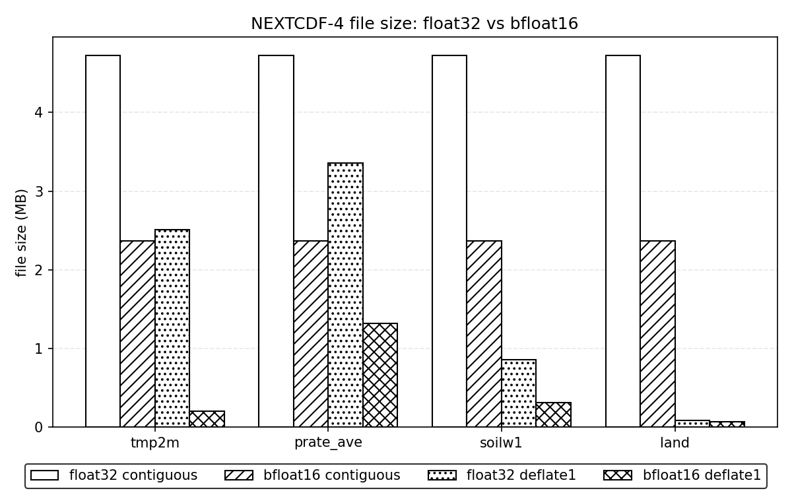
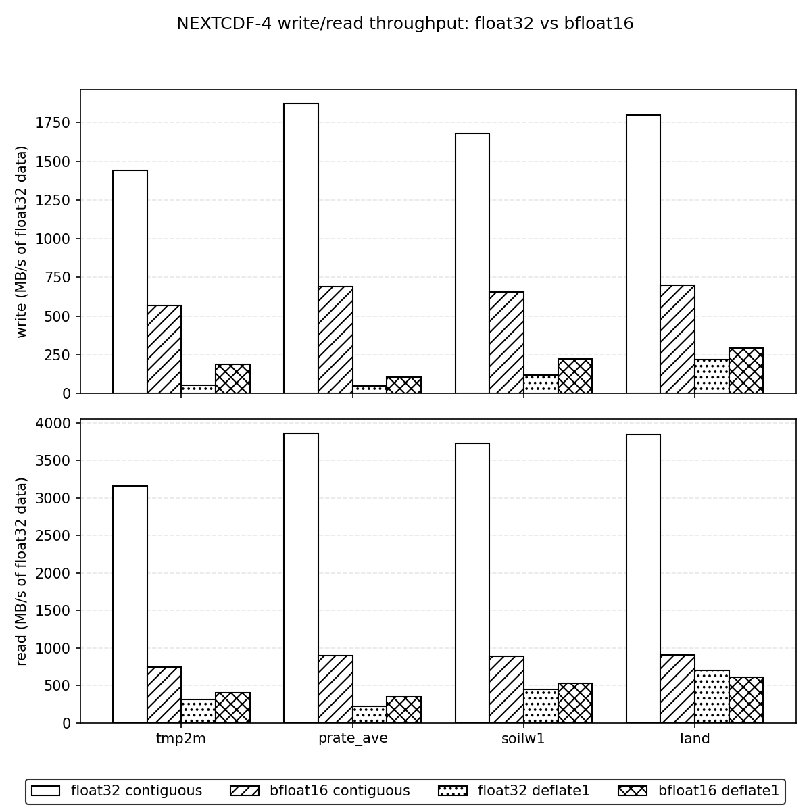

# NEXTCDF-4 float16 Storage

NEXTCDF-4 supports two 16-bit floating-point atomic types: `NC_FLOAT16` (IEEE 754 binary16) and `NC_BFLOAT16` (brain floating point). Both store 2 bytes per value on disk, but they split the bits differently and suit different data.

| Property | `NC_FLOAT16` | `NC_BFLOAT16` |
|----------|--------------|---------------|
| `nc_type` value | 17 (`include/nep.h`) | 18 (`include/nep.h`) |
| Layout | 1 sign, 5 exponent, 10 mantissa bits | 1 sign, 8 exponent, 7 mantissa bits |
| Range | up to 65504 | float32 range, up to ~3.39e38 |
| Precision | ~3 significant decimal digits | ~2-3 significant decimal digits |
| File type | `H5T_IEEE_F16LE` | `H5T_FLOAT_BFLOAT16LE` |
| Memory type | `H5T_NATIVE_FLOAT16` (raw `uint16_t`) | `H5T_FLOAT_BFLOAT16LE` (raw `uint16_t`) |

Even smaller floats exist — `NC_FLOAT8_E4M3`, `NC_FLOAT8_E5M2`, `NC_FLOAT6_E2M3`, `NC_FLOAT6_E3M2` and `NC_FLOAT4_E2M1` are stored as raw `uint8_t` patterns; see the type table in [nextcdf4.md](nextcdf4.md).

## Rules

- **Native mode only.** Small floating-point types are rejected with `NC_ENOTNC4` in `NC_NETCDF4_MODEL` and `NC_CLASSIC_MODEL` mode (`NEXTCDF4_check_atomic_type` in `src/nextcdf4/nxt4meta.c`).
- **No coordinate variables.** Small floating-point types are not supported as coordinate variables by design (v4.0.0 Sprint 9). The library does not currently reject a 1-D variable whose name matches its dimension, and reopening such a file is untested, so do not create them yet ([issue #380](https://github.com/Intelligent-Data-Design-Inc/NEP/issues/380)).
- **Raw bit patterns in memory.** In-memory data is the raw 16-bit pattern carried in a `uint16_t`; there is no automatic conversion to or from `float`/`double`. Convert in user code (see `examples/nextcdf4/bfloat16_conv.h`).
- **Untyped I/O calls only.** Use `nc_put_vara`/`nc_get_vara` (or `nc_put_var`/`nc_get_var`) with a `uint16_t` buffer. Typed calls such as `nc_get_vara_float` on a `NC_BFLOAT16` variable return `NC_NOERR` without converting or reading any data ([issue #376](https://github.com/Intelligent-Data-Design-Inc/NEP/issues/376)).
- **No fill value.** `_FillValue` attributes on `NC_BFLOAT16` variables are rejected, and a fill value set with `nc_def_var_fill` is not recovered on reopen ([issue #377](https://github.com/Intelligent-Data-Design-Inc/NEP/issues/377)). Define small-float variables without a fill value.
- NEXTCDF-4 itself requires HDF5 2.1.1, so both types are available whenever NEXTCDF-4 is built. (The per-type minimums are HDF5 1.14 for `NC_FLOAT16` and HDF5 2.1.1 for `NC_BFLOAT16`.)

## Why bfloat16 for the GDAS sample

bfloat16 keeps the full float32 exponent range and pays for it with a 7-bit mantissa, so it suits data where a relative error of up to 2^-8 (about 0.4%) is acceptable. IEEE binary16 makes the opposite trade: 3 more mantissa bits (for example, values 0.25 K apart in 256-512 K instead of 2 K), but a maximum of 65504 and a smallest normal value of about 6.1e-5, below which precision drops. The non-fill values in this sample (`tmp2m` 218.976-316.82 K, `prate_ave` 0-0.0109397 kg/m**2/s, `soilw1` 0.02-1, `land` 0-2) all fit within binary16's maximum, but the input's declared fill value `9.99e+20` and any small `prate_ave` values below 6.1e-5 do not fit binary16 well, while bfloat16 represents both. (No point in this sample actually equals the fill value.) In absolute terms the maximum errors on the four GDAS fields are 1 K for `tmp2m` (bfloat16 values are 1 K apart in 128-256 K and 2 K apart in 256-512 K, so `tmp2m` is stored to the nearest 1-2 K), 3.0e-05 kg/m**2/s for `prate_ave`, 9.8e-04 (fraction) for `soilw1`, and 0 for `land`, whose three small integer values are exactly representable.

## Example: `examples/nextcdf4/bfloat16.c`

`bfloat16.c` reads the `tmp2m` field and its `grid_yt`/`grid_xt` coordinate variables from the GDAS sample, writes two NEXTCDF-4 files — `float_tmp2m.nc` (`NC_FLOAT`) and `bfloat16_tmp2m.nc` (`NC_BFLOAT16`) — then reopens the bfloat16 file, verifies the bits round-tripped exactly, and reports file sizes and the maximum conversion error.

### Conversion (bfloat16_conv.h)

float32 to bfloat16 rounds to nearest, ties to even; NaN stays a quiet NaN and values past the maximum overflow to infinity. bfloat16 to float32 is an exact 16-bit left shift:

```c
static inline uint16_t
float_to_bfloat16(float f)
{
    uint32_t u;

    memcpy(&u, &f, sizeof(u));
    if ((u & 0x7fffffffu) > 0x7f800000u)
        return (uint16_t)((u >> 16) | 0x0040u);
    return (uint16_t)((u + 0x7fffu + ((u >> 16) & 1u)) >> 16);
}

static inline float
bfloat16_to_float(uint16_t b)
{
    uint32_t u = (uint32_t)b << 16;
    float f;

    memcpy(&f, &u, sizeof(f));
    return f;
}
```

### Writing the bfloat16 file

The file is created with `NC_NEXTCDF4`, the variable is defined with `NC_BFLOAT16` and no fill value, and the raw `uint16_t` bits are written with the untyped `nc_put_vara`:

```c
if ((ret = nc_create(path, NC_NEXTCDF4 | NC_CLOBBER, &ncid))) ERR(ret);
...
if ((ret = nc_def_var(ncid, "tmp2m", xtype, 3, dimids, &varid))) ERR(ret);
if ((ret = nc_def_var_fill(ncid, varid, NC_NOFILL, NULL))) ERR(ret);
...
/* Typed calls such as nc_put_vara_float must not be used on
 * NC_BFLOAT16 variables; the untyped nc_put_vara passes the raw
 * bits through unchanged for both NC_FLOAT and NC_BFLOAT16. */
if ((ret = nc_put_vara(ncid, varid, start, count, data))) ERR(ret);
```

### Reopening and checking

The program reopens `bfloat16_tmp2m.nc` with `NC_NEXTCDF4 | NC_NOWRITE`, checks `nc_inq_vartype` returns `NC_BFLOAT16`, reads the bits with `nc_get_vara` into a `uint16_t` buffer, `memcmp`s them against the written bits, and computes the maximum absolute and relative error over the non-fill points.

### Building and running

```sh
cmake -S . -B build -DNEP_ENABLE_NEXTCDF4=ON -DNEP_BUILD_EXAMPLES=ON \
      -DNEP_ZSTD_PLUGIN_DIR=$HOME/plugins/zstd-only
cmake --build build -j

cd build/examples/nextcdf4
HDF5_PLUGIN_PATH=$HOME/plugins/zstd-only \
NCRCENV_RC=<build>/.ncrc NETCDF_RC=<build> \
./bfloat16 ../../../test/data/netCDF-4/gdas_sfc_sample.nc
```

`-DNEP_ZSTD_PLUGIN_DIR` points ctest at a directory holding exactly one HDF5 zstd plugin, needed to read the compressed sample; `NCRCENV_RC`/`NETCDF_RC` point netcdf-c at the build-tree `.ncrc` that autoloads the NEXTCDF-4 backend. Real output on the reference machine:

```
tmp2m: 1179648 values
float32  file: 4744291 bytes
bfloat16 file: 2384815 bytes (50.3% of float32)
max abs error: 1 K
max rel error: 0.00389105
```

`h5dump -H bfloat16_tmp2m.nc` shows `DATATYPE H5T_FLOAT_BFLOAT16LE` for `tmp2m`.

## Benchmark: `bfloat16_perf` and `plot_bfloat16.py`

`bfloat16_perf.c` runs all four GDAS fields (`tmp2m`, `prate_ave`, `soilw1`, `land`) through four configurations — `float`/`bfloat16` x `contiguous`/`deflate1` (shuffle + deflate level 1, chunks of 1x768x1536) — with 3 repetitions each, keeping the minimum times. Write time runs from just before conversion (bfloat16 only) through `nc_close`; read time runs from `nc_open` through `nc_close` plus the conversion back to float. Each row is checked bit-exact and the program fails if any contiguous bfloat16 file is not smaller than its float file, or if any relative error exceeds 2^-8.

The CSV written has columns:

```
field,type,storage,uncompressed_bytes,file_bytes,ratio_vs_float,write_s,read_s,write_MBps,read_MBps,max_abs_err,max_rel_err,wconv_s,rconv_s
```

(`ratio_vs_float` is the matching float row's `file_bytes` divided by this row's; throughput is measured in MB/s of float32 data for every row. `wconv_s`/`rconv_s` are the minimum float32-to-bfloat16 and bfloat16-to-float32 conversion times — parts of `write_s`/`read_s`; 0 for float rows.)

```sh
HDF5_PLUGIN_PATH=$HOME/plugins/zstd-only \
NCRCENV_RC=<build>/.ncrc NETCDF_RC=<build> \
./bfloat16_perf ../../../test/data/netCDF-4/gdas_sfc_sample.nc bfloat16_results.csv
python3 ../../../examples/nextcdf4/plot_bfloat16.py bfloat16_results.csv bfloat16
```

### Results

Measured on the machine recorded in `examples/nextcdf4/reference_machine.txt`; the full CSV is `examples/nextcdf4/reference_results.csv`. File sizes are in bytes.

| Field | float contiguous | bfloat16 contiguous | float deflate1 | bfloat16 deflate1 | max rel err |
|-------|-----------------:|--------------------:|---------------:|------------------:|------------:|
| `tmp2m` | 4724931 | 2365635 | 2507866 | 203408 | 0.00389105 |
| `prate_ave` | 4724931 | 2365635 | 3359982 | 1321355 | 0.00389081 |
| `soilw1` | 4724931 | 2365635 | 859442 | 307824 | 0.00388914 |
| `land` | 4724931 | 2365635 | 81474 | 70249 | 0 |





What the numbers show:

- Every contiguous bfloat16 file is 2365635 bytes, 50.1% of its float file (ratio 1.997) — essentially the 2:1 element-size ratio plus fixed metadata.
- With shuffle+deflate level 1, bfloat16 compresses much better than float32, because rounding collapses the number of distinct values the filters see. The four fields contain 858874 (`tmp2m`), 954856 (`prate_ave`), 202809 (`soilw1`) and 3 (`land`) distinct float32 values; after bfloat16 rounding only 68, 6114, 594 and 3 distinct values remain. Compressed sizes drop accordingly: 203408 vs 2507866 bytes for `tmp2m` (12.3x smaller), 1321355 vs 3359982 for `prate_ave` (2.5x), and 307824 vs 859442 for `soilw1` (2.8x). `land` already has only 3 distinct values, so rounding changes nothing and the compressed files are close in size (70249 vs 81474 bytes, 1.16x).
- The maximum relative error is 0.00389 across all fields, just under the 2^-8 = 0.00390625 round-to-nearest bound; `land` is exact because its three values are representable in bfloat16.
- bfloat16 total times are dominated by the in-memory conversion, not I/O. For `tmp2m` contiguous, `write_s` is 0.008339 s of which `wconv_s` is 0.005705 s — the actual write I/O (~0.0026 s) is slightly faster than the float write (0.003273 s), as expected for half the bytes. The same holds for reads: `read_s` 0.006293 s minus `rconv_s` 0.005213 s leaves ~0.0011 s against 0.001493 s for float. With deflate1 the I/O savings grow with the compression gain: `tmp2m` bfloat16 write I/O is ~0.0196 s versus 0.0913 s for float, so even including conversion the total is faster (0.025325 s vs 0.091306 s).
