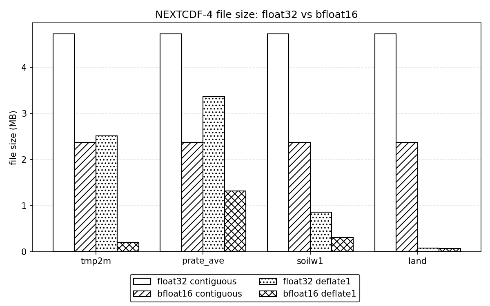
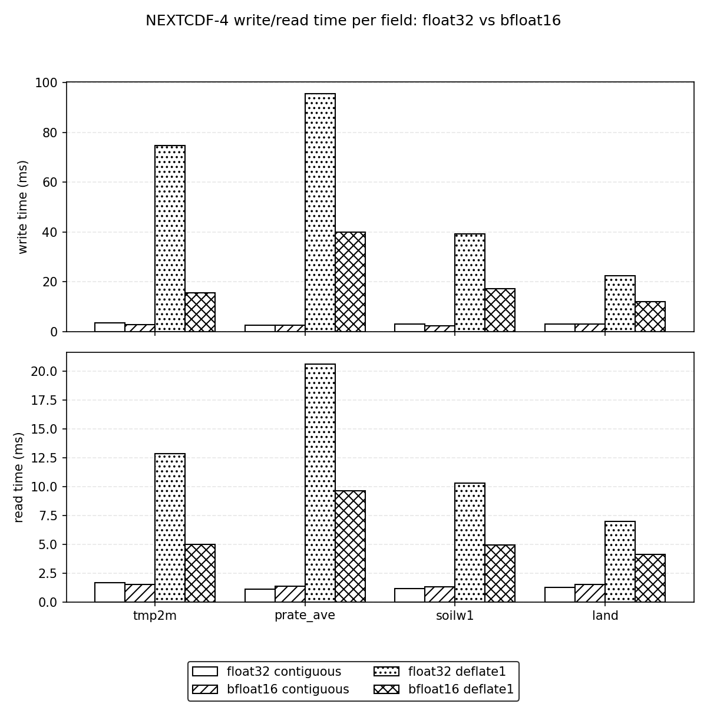
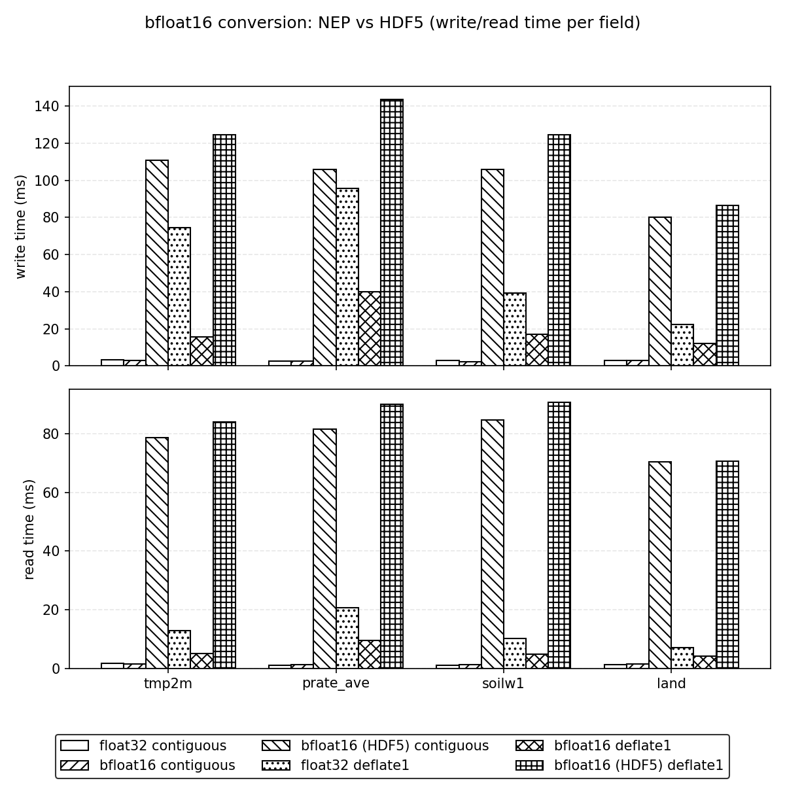
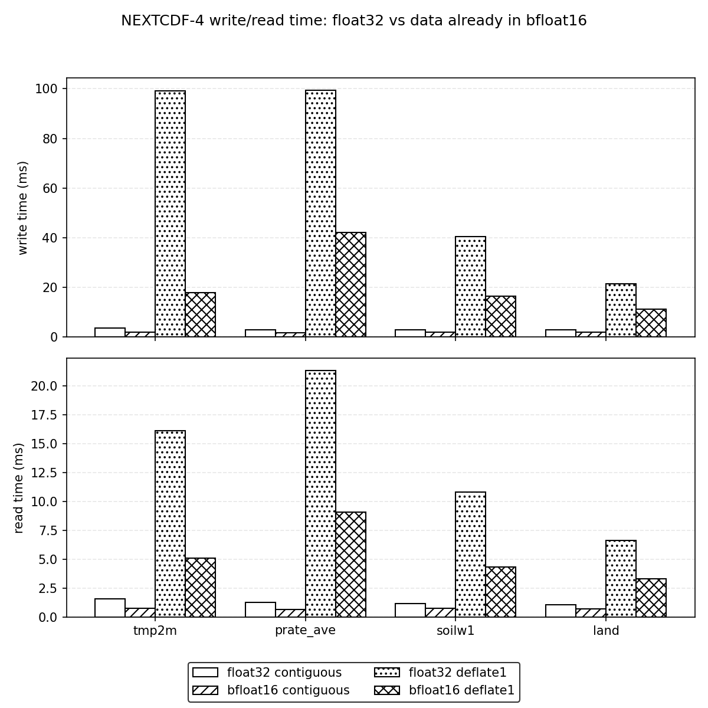

# bfloat16 in NEP

bfloat16 ("brain floating point") is a 16-bit floating-point format: 1 sign bit, 8 exponent bits and 7 mantissa bits. It is the top half of an IEEE float32, so it keeps float32's full range (up to about 3.39e38) and gives up precision: about 2-3 significant decimal digits, with a relative rounding error of at most 2^-8 (about 0.4%). For data that doesn't need more precision than that, such as many model output fields, bfloat16 halves the storage of float32 and often compresses much better.

NEP supports bfloat16 in two ways:

- **On disk**: the NEXTCDF-4 backend stores `NC_BFLOAT16` variables as HDF5 `H5T_FLOAT_BFLOAT16LE` datasets, 2 bytes per value.
- **In memory**: `libnep` provides `nc_get_*_bfloat16`/`nc_put_*_bfloat16` functions that exchange bfloat16 data with `NC_BFLOAT16`, `NC_FLOAT` and `NC_DOUBLE` variables, rounding correctly to nearest, ties to even.

This page gives an overview with code from `examples/nextcdf4/bfloat16.c` and the benchmark results. The full reference, including `NC_FLOAT16` and the HDF5 conversion details, is [NEXTCDF4_float16.md](NEXTCDF4_float16.md).

## Capabilities

### The `NC_BFLOAT16` type

`NC_BFLOAT16` (value 18, defined in `include/nep.h`) is a NEXTCDF-4 atomic type. To use it:

- Create the file with `NC_NEXTCDF4`. The type is rejected in the netCDF-4 compatibility modes (`NC_NETCDF4_MODEL`, `NC_CLASSIC_MODEL`).
- Build NEP with NEXTCDF-4 enabled (`-DNEP_ENABLE_NEXTCDF4=ON`), which requires HDF5 2.1.1.
- Define the variable without a fill value (`nc_def_var_fill(..., NC_NOFILL, NULL)`); bfloat16 fill values are not yet supported ([#377](https://github.com/Intelligent-Data-Design-Inc/NEP/issues/377)).
- Don't use it for coordinate variables ([#380](https://github.com/Intelligent-Data-Design-Inc/NEP/issues/380)).

A 16-bit IEEE half-precision type, `NC_FLOAT16`, is also available. It has 3 more mantissa bits than bfloat16 but a maximum of 65504. See [NEXTCDF4_float16.md](NEXTCDF4_float16.md) for a comparison.

### The bfloat16 I/O functions

`libnep` declares eight functions in `nep.h`, following the netCDF naming pattern:

```c
nc_get_var_bfloat16   nc_put_var_bfloat16
nc_get_var1_bfloat16  nc_put_var1_bfloat16
nc_get_vara_bfloat16  nc_put_vara_bfloat16
nc_get_vars_bfloat16  nc_put_vars_bfloat16
```

For example:

```c
int nc_get_vara_bfloat16(int ncid, int varid, const size_t *startp,
                         const size_t *countp, nc_bfloat16_t *ip);
int nc_put_vara_bfloat16(int ncid, int varid, const size_t *startp,
                         const size_t *countp, const nc_bfloat16_t *op);
```

The buffer type `nc_bfloat16_t` is the compiler's `__bf16` where the compiler supports it (for example GCC 13 on x86-64; clang 18 supports `__bf16` but NEP doesn't detect it, so clang gets `uint16_t`; `NEP_HAVE_NATIVE_BFLOAT16` is 1), and `uint16_t` otherwise. Either way it is 2 bytes holding the bfloat16 bit pattern. With `__bf16`, C casts between values convert numerically, so code that keeps raw bits in a `uint16_t` array passes it by casting the pointer, `(nc_bfloat16_t *)(void *)bits`, as the example does.

What the functions do depends on the type of the variable in the file:

| Variable type | Read (`nc_get_*_bfloat16`) | Write (`nc_put_*_bfloat16`) |
|---------------|----------------------------|-----------------------------|
| `NC_BFLOAT16` | raw bits, no conversion | raw bits, no conversion; stored as 2 bytes per value |
| `NC_FLOAT` | NEP rounds each float to bfloat16 (to nearest, ties to even) | NEP widens each value to float (exact); stored as 4 bytes |
| `NC_DOUBLE` | NEP rounds each double to bfloat16 in a single rounding | NEP widens each value to double (exact); stored as 8 bytes |
| `NC_CHAR` | `NC_ECHAR` | `NC_ECHAR` |
| any other type | `NC_EBADTYPE` | `NC_EBADTYPE` |

On a read, a finite value too large for bfloat16 is stored as ±infinity, the rest of the values are still converted, and the call returns `NC_ERANGE`, as netCDF's own typed calls do. Writes never overflow.

The functions use only the public netCDF API, so they work on any file netCDF can open. You can read an `NC_FLOAT` variable from an ordinary netCDF-4 file as bfloat16, as the example does with its input. Note that writing into an `NC_FLOAT` or `NC_DOUBLE` variable saves no space; only an `NC_BFLOAT16` variable in a NEXTCDF-4 file stores 2 bytes per value.

### Other ways to read and write bfloat16

- The untyped `nc_get_vara`/`nc_put_vara` calls on an `NC_BFLOAT16` variable also exchange raw bits, in a `uint16_t` buffer.
- The typed `float` and `double` calls (`nc_get_vara_float`, `nc_put_vara_double`, ...) on an `NC_BFLOAT16` variable convert through HDF5. Reads are exact. Writes round ties away from zero rather than to even, saturate finite float input past the bfloat16 maximum instead of giving infinity, and don't return `NC_ERANGE` ([#381](https://github.com/Intelligent-Data-Design-Inc/NEP/issues/381)). HDF5's conversion is also much slower (see the benchmark below).

## Example: `examples/nextcdf4/bfloat16.c`

The example uses `test/data/netCDF-4/gdas_sfc_sample.nc`, a sample of NOAA GDAS surface output with 1,179,648 values per field (768 x 1536 grid). It reads the 2 m temperature field `tmp2m`, writes it to a float32 file and a bfloat16 file, reopens the bfloat16 file and checks the result.

### Reading a float variable as bfloat16

The input is an ordinary netCDF-4 file with `tmp2m` stored as `NC_FLOAT`. The program reads it twice: once as float for reference, and once as bfloat16, so NEP does the conversion:

```c
if ((ret = nc_open(argv[1], NC_NOWRITE, &ncid))) ERR(ret);
...
if ((ret = nc_get_var_float(ncid, varid, fdata))) ERR(ret);
/* Read the same field a second time as bfloat16; NEP does the
 * conversion. */
if ((ret = nc_get_var_bfloat16(ncid, varid, (nc_bfloat16_t *)(void *)bdata))) ERR(ret);
```

It then checks NEP's conversion against the reference conversion in `examples/nextcdf4/bfloat16_conv.h`, which rounds to nearest, ties to even:

```c
for (i = 0; i < NVALS; i++)
    if (bdata[i] != float_to_bfloat16(fdata[i]))
        n_conv_bad++;
```

### Writing an `NC_BFLOAT16` variable

The bfloat16 file is created with `NC_NEXTCDF4`, `tmp2m` is defined as `NC_BFLOAT16` with no fill value, and the bits are written with `nc_put_vara_bfloat16`. The float32 file is written the same way with `NC_FLOAT` and `nc_put_vara_float`:

```c
if ((ret = nc_create(path, NC_NEXTCDF4 | NC_CLOBBER, &ncid))) ERR(ret);
...
if ((ret = nc_def_var(ncid, "tmp2m", xtype, 3, dimids, &varid))) ERR(ret);
if ((ret = nc_def_var_fill(ncid, varid, NC_NOFILL, NULL))) ERR(ret);
...
if (xtype == NC_BFLOAT16)
{
    if ((ret = nc_put_vara_bfloat16(ncid, varid, start, count,
                                    (nc_bfloat16_t *)(void *)data))) ERR(ret);
}
else
{
    if ((ret = nc_put_vara_float(ncid, varid, start, count, data))) ERR(ret);
}
```

### Reading it back

The program reopens the file with `NC_NEXTCDF4 | NC_NOWRITE` and reads the raw bits with `nc_get_vara_bfloat16`. As a cross-check, it also reads the same values as float through HDF5's (exact) widening conversion:

```c
if ((ret = nc_get_vara_bfloat16(ncid, varid, start, count,
                                (nc_bfloat16_t *)(void *)bdata_in))) ERR(ret);
if ((ret = nc_get_vara_float(ncid, varid, start, count, typed_in))) ERR(ret);
```

Its output on the reference machine:

```
tmp2m: 1179648 values
float32  file: 4743920 bytes
bfloat16 file: 2384624 bytes (50.3% of float32)
max abs error: 1 K
max rel error: 0.00389105
typed nc_get_vara_float: 0 mismatches
nc_get_var_bfloat16 vs float_to_bfloat16: 0 mismatches
```

The bfloat16 file is half the size, and the largest error is 1 K out of about 220-317 K, a relative error just under the 2^-8 (0.00390625) bound. Build and run instructions are in [NEXTCDF4_float16.md](NEXTCDF4_float16.md).

## Performance

`examples/nextcdf4/bfloat16_perf.c` writes and reads four GDAS fields (`tmp2m` temperature, `prate_ave` precipitation rate, `soilw1` soil moisture, and `land` land mask) in six configurations:

- **float32**: an `NC_FLOAT` variable.
- **bfloat16**: an `NC_BFLOAT16` variable. The program converts with `float_to_bfloat16()`/`bfloat16_to_float()` and does the I/O with `nc_put_vara_bfloat16`/`nc_get_vara_bfloat16`. The conversion time is included in the write and read times.
- **bfloat16 (HDF5)**: the same `NC_BFLOAT16` variable, written with `nc_put_vara_float` and read with `nc_get_vara_float`, so HDF5 does the conversion.

Each is run with **contiguous** storage and with **deflate1** (shuffle plus deflate level 1, one 768 x 1536 chunk). Every configuration runs 3 times and the minimum time is kept. The results below come from a `RelWithDebInfo` (`-O2`) build on the machine (Intel i7-6800K, HDF5 2.1.1, NetCDF-C 4.10.2-development) recorded in `examples/nextcdf4/reference_machine.txt`, and the full results are in `examples/nextcdf4/reference_results.csv`.

### File size



**Figure 1.** File size in MB for each field, in the four main configurations (float32/bfloat16 x contiguous/deflate1). Contiguous bfloat16 files are 2.37 MB against 4.72 MB for float32 (ratio 1.997), whichever way the data was converted. With deflate1, bfloat16 compresses much better than float32, because rounding to 7 mantissa bits leaves far fewer distinct values: `tmp2m` drops from 858,874 distinct values to 68, and its file from 2.51 MB to 0.20 MB (12.3x smaller); `prate_ave` is 2.5x smaller and `soilw1` 2.8x. `land` has only 3 distinct values, all exact in bfloat16, so both versions compress to well under 0.1 MB (1.16x).

### Write and read time



**Figure 2.** Time in milliseconds to write (top) or read (bottom) one field, 1,179,648 values, in the four main configurations. Write time runs from the start of any conversion through `nc_close`; read time from `nc_open` through `nc_close` plus any conversion back to float. Each bar is the fastest of 3 runs. Shorter is better.

- Contiguous bfloat16 is faster than float32: 2.4-2.9 ms to write and 1.3-1.5 ms to read, against 2.5-3.4 ms and 1.1-1.7 ms for float32. The optimized `float_to_bfloat16()`/`bfloat16_to_float()` loops cost only 0.6-0.8 ms per field, less than the time saved by writing and reading half as many bytes.
- With deflate1, bfloat16 is faster for every field, conversion included, because the compressor has less and simpler data to handle: `tmp2m` writes in 15.5 ms against 74.7 ms for float32 and reads in 5.0 ms against 12.9 ms. The smallest gain is on `land` (12.0 ms against 22.5 ms to write, 4.1 against 7.0 ms to read), which float32 already compresses to 81 KB.

### Converting in HDF5

The same `NC_BFLOAT16` variable can also be written with `nc_put_vara_float` and read with `nc_get_vara_float`, letting HDF5 do the conversion inside `H5Dwrite`/`H5Dread`. Figure 3 adds those bars to the same write/read time chart.



**Figure 3.** The same write (top) and read (bottom) times with the bfloat16 (HDF5) configurations added.

- Converting in HDF5 is slow in every case: 80.2-143.4 ms to write and 67.0-90.7 ms to read. For `tmp2m` contiguous that is 110.7 ms to write against 2.8 ms with NEP's conversion (about 40x slower) and 78.6 ms to read against 1.5 ms. HDF5 has no compiled conversion for bfloat16 and uses its generic software path, value by value.
- The files are the same size, and only a few stored values differ from round-to-nearest-even in the last bit — 9 of 1,179,648 for `tmp2m`, 8 for `prate_ave`, 3 for `soilw1` and 0 for `land` — because HDF5 rounds ties away from zero while `float_to_bfloat16()` and the `nc_*_bfloat16` functions round ties to even.

### Writing and reading data already in bfloat16

A second benchmark, `examples/nextcdf4/bfloat16_io_perf.c`, measures pure I/O with no conversion at all. It uses `test/data/NEXTCDF4/gdas_sfc_sample_bfloat16.nc`, a bfloat16 copy of the GDAS sample made by `make_bfloat16_sample` (the values come from `nc_get_var_bfloat16` on the source `NC_FLOAT` variables; `time` is a fixed dimension of length 1, and the data variables carry no `_FillValue`/`missing_value`, so fill points hold the bfloat16 rounding of 9.99e+20). The benchmark checks that the sample's bits are exactly `float_to_bfloat16()` of the float sample, then times writing and reading the float32 data and the bfloat16 bits in the four configurations. Write and read times cover `nc_create`/`nc_open` through `nc_close` only.



**Figure 4.** Pure I/O time in milliseconds to write (top) or read (bottom) one field held as float32 or as bfloat16 bits, in each configuration. Speedups are the float32 time of the same storage configuration divided by the bfloat16 time.

- With deflate1, reading data already stored as bfloat16 is 2.0-3.2x faster than float32 (`tmp2m` 5.1 ms against 16.1 ms) and writing is 1.9-5.5x faster (`tmp2m` 18.0 ms against 99.2 ms). The gains track the compression ratios: largest for `tmp2m` (12.3x smaller file), smallest for `land` (1.16x).
- Contiguous bfloat16 is faster too: writes are 1.5-1.9x faster (1.6-1.9 ms against 2.9-3.6 ms for float32) and reads 1.5-2.1x faster (0.65-0.75 ms against 1.07-1.57 ms), because there are half as many bytes to move.

### Accuracy

The maximum relative error is 0.00389 for `tmp2m`, `prate_ave` and `soilw1` in every bfloat16 configuration, just under the 2^-8 bound, and 0 for `land`. In absolute terms that is 1 K for `tmp2m`, 3.0e-05 kg/m²/s for `prate_ave` and 9.8e-04 for `soilw1`.

## Summary

- Store data as `NC_BFLOAT16` in a NEXTCDF-4 file when about 2-3 significant digits are enough. Files are half the size uncompressed, and with compression they are often several times smaller.
- Data already stored as bfloat16 is also faster to write and read: 1.9-5.5x faster writes and 2.0-3.2x faster reads than float32 with deflate1, and 1.5-2.1x contiguous, with no conversion cost at all.
- Use the `nc_*_bfloat16` functions for I/O. On `NC_BFLOAT16` variables they pass the bits through with no conversion cost; on `NC_FLOAT`/`NC_DOUBLE` variables they convert correctly and quickly, and report overflow with `NC_ERANGE`.
- Avoid the typed `float`/`double` calls on `NC_BFLOAT16` variables when speed or exact round-to-even results matter, since they use HDF5's slow conversion.
